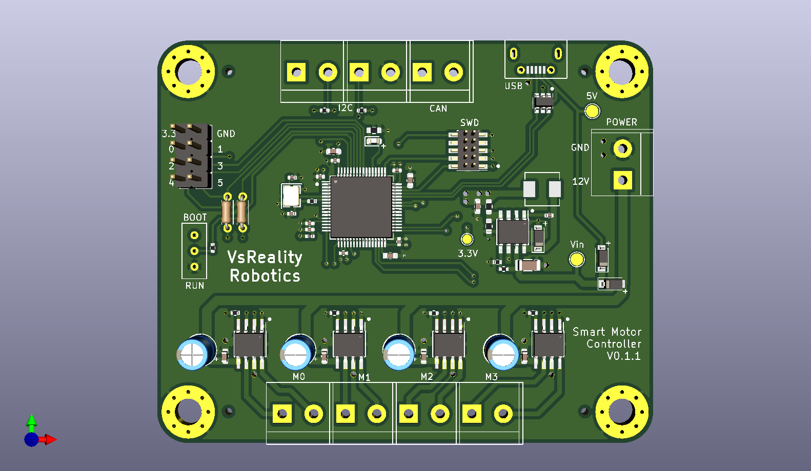

# Kinisi Motor Controller
For the current **v0.4** hardware, pin mappings, electrical limits and firmware compatibility, see [README_V4.md](README_V4.md). The overview below describes earlier revisions; interface counts and pin assignments differ.

For repeatable Gerber, drill, BOM and placement exports, see
[Regenerating a production package](README_V4.md#regenerating-a-production-package).

Kinisi motor controller is based on STM32F405 microcontroller controller. The controller can control up to 4 brushed DC motors with encoders. It offers platform obstruction which is means user doesn’t need to control each individual motor form main computer, but rather it can control up to four motors as a whole by sending high level commands like set target speed or distance for a platform.

Features:
* Controls 4 motors
* Receives readings from 4 encoders
* Supports encoders with wide range of supply voltage (3.3V, 5V, custom) 

Interfaces:
* USB Serial device
* I2C
* CAN
* 4x GPIO
